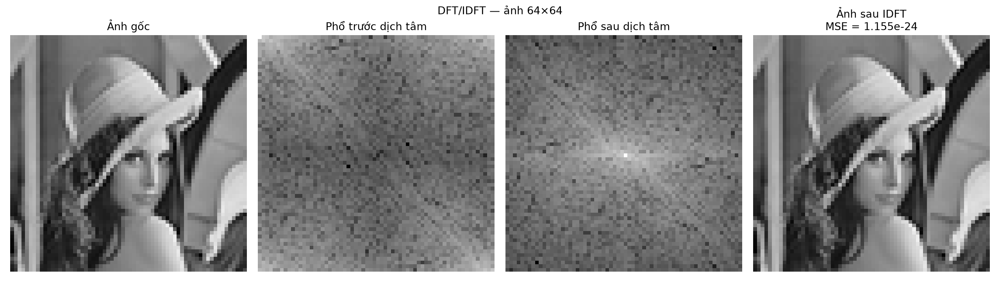
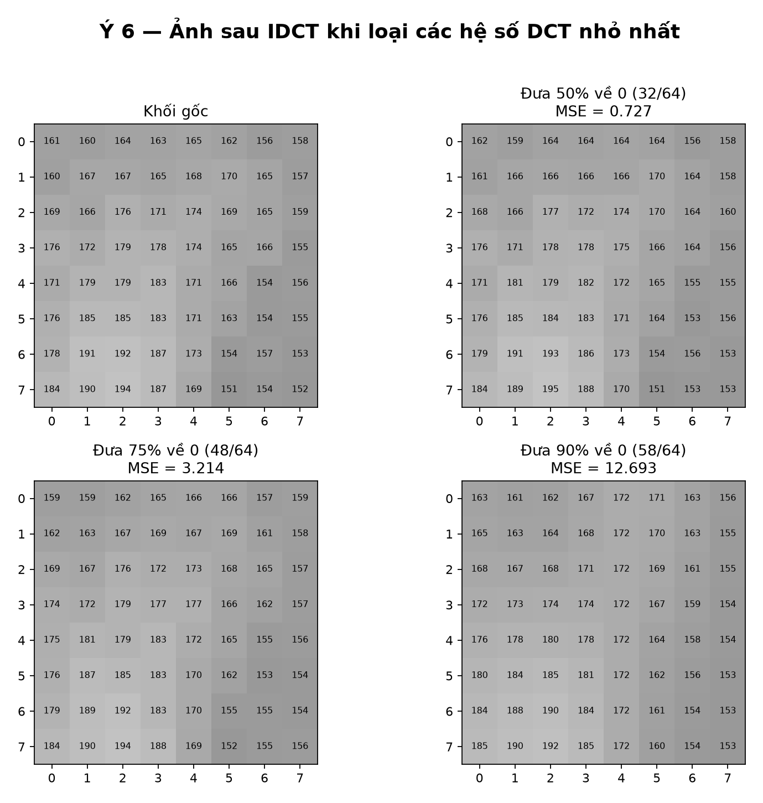
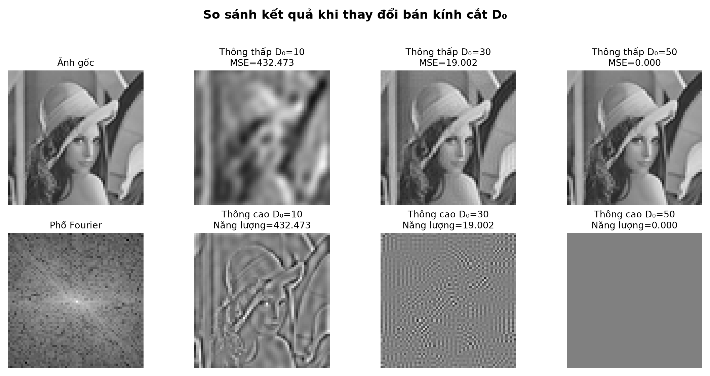
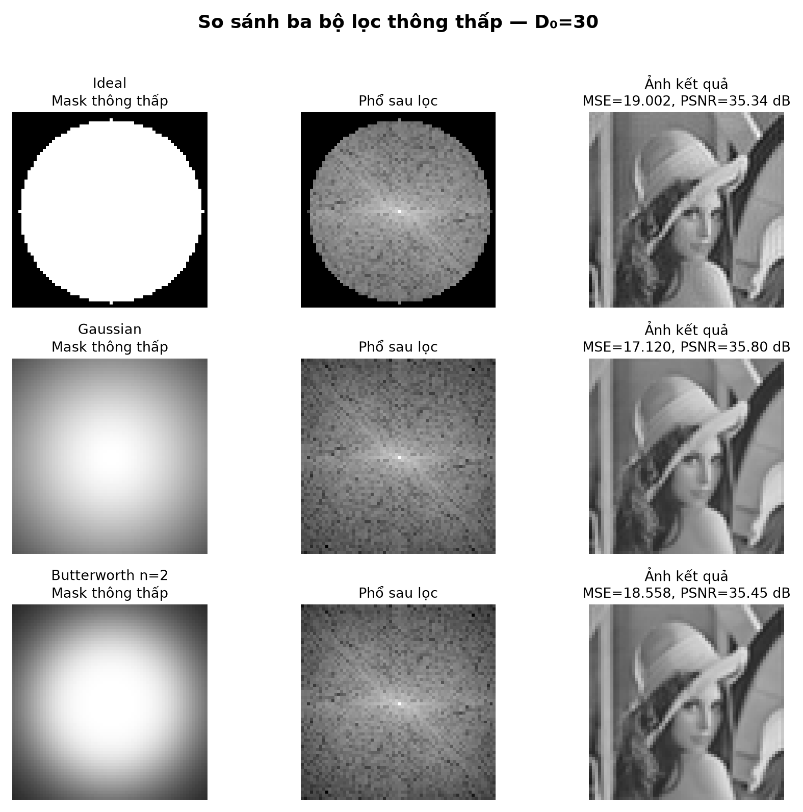

# Thực hành 4 – Xử lý ảnh trong miền tần số

Repository chứa mã nguồn và kết quả của 4 bài thực hành về DFT/IDFT, DCT/IDCT
và các bộ lọc trong miền tần số.

**Sinh viên:** Ngô Thiện Đắc – 23020734  
**Môn học:** Xử lý ảnh – Thị giác Robot

## Nội dung

### Bài 1 – Xây dựng DFT và IDFT 2 chiều

File: [`bai1_dft_idft.py`](bai1_dft_idft.py)

- Đọc ảnh xám kích thước 32×32 và 64×64.
- Tự xây dựng DFT/IDFT bằng công thức tổng kép, không dùng `np.fft`.
- Tính phần thực, phần ảo, phổ biên độ và phổ pha.
- Tự dịch tâm phổ, không dùng `fftshift()`.
- Khôi phục ảnh và đánh giá bằng MSE.



### Bài 2 – Xây dựng DCT và IDCT cho khối ảnh 8×8

File: [`bai2_dct_idct.py`](bai2_dct_idct.py)

- Chọn một khối 8×8 từ ảnh xám.
- Tự xây dựng DCT/IDCT 2 chiều.
- Hiển thị hệ số DC, các hệ số AC và ảnh khôi phục.
- Lưu ma trận hệ số DCT vào tệp văn bản.
- Loại 50%, 75% và 90% hệ số có độ lớn nhỏ nhất rồi so sánh MSE.



### Bài 3 – Bộ lọc thông thấp và thông cao lý tưởng

File: [`bai3_bo_loc_tan_so.py`](bai3_bo_loc_tan_so.py)

- Tái sử dụng DFT/IDFT tự xây dựng ở Bài 1.
- Xây dựng Ideal Low-Pass Filter và Ideal High-Pass Filter.
- Thử nghiệm với `D0 = 10, 30, 50`.
- Hiển thị ảnh gốc, phổ Fourier, mask và ảnh sau lọc.



### Bài 4 – So sánh Ideal, Gaussian và Butterworth

File: [`bai4_so_sanh_bo_loc.py`](bai4_so_sanh_bo_loc.py)

- Xây dựng ba bộ lọc thông thấp: Ideal, Gaussian và Butterworth.
- Thử `D0 = 10, 30, 50, 80` và Butterworth với `n = 1, 2, 4`.
- So sánh mask, phổ sau lọc, ảnh kết quả, MSE và PSNR.
- Xây dựng các bộ lọc thông cao tương ứng và làm sắc nét ảnh.
- Khảo sát hiện tượng ringing.



## Cấu trúc thư mục

```text
XLA_th4/
├── bai1_dft_idft.py
├── bai2_dct_idct.py
├── bai3_bo_loc_tan_so.py
├── bai4_so_sanh_bo_loc.py
├── tuan4_image.py
├── tao_so_do_dct.py
├── robot_goc.png
├── week4_image.png
├── output_bai1/
├── output_bai1_week4_image/
├── output_bai2_dct/
├── output_bai3_bo_loc_tan_so/
└── output_bai4_so_sanh_bo_loc/
```

## Yêu cầu môi trường

- Python 3.10 trở lên.
- NumPy.
- Pillow.
- Matplotlib.

Cài các thư viện:

```bash
python -m pip install -r requirements.txt
```

## Cách chạy

Chạy tại thư mục gốc của repository:

```bash
python bai1_dft_idft.py
python bai2_dct_idct.py
python bai3_bo_loc_tan_so.py
python bai4_so_sanh_bo_loc.py
```

Theo mặc định, chương trình lưu hình vào các thư mục `output_*` mà không mở
cửa sổ đồ họa. Để vừa chạy vừa hiển thị hình:

```bash
python bai4_so_sanh_bo_loc.py --hien-thi
```

## Lưu ý

- Bài 1 sử dụng DFT/IDFT tổng kép tự xây dựng để bám sát công thức lý thuyết,
  vì vậy chạy chậm hơn nhiều so với FFT.
- Bài 3 và Bài 4 tái sử dụng các hàm DFT/IDFT của Bài 1.
- Ảnh được xử lý ở kích thước nhỏ để thời gian tính toán thủ công hợp lý.
- Các file báo cáo Word/PDF không được đưa vào repository này.

